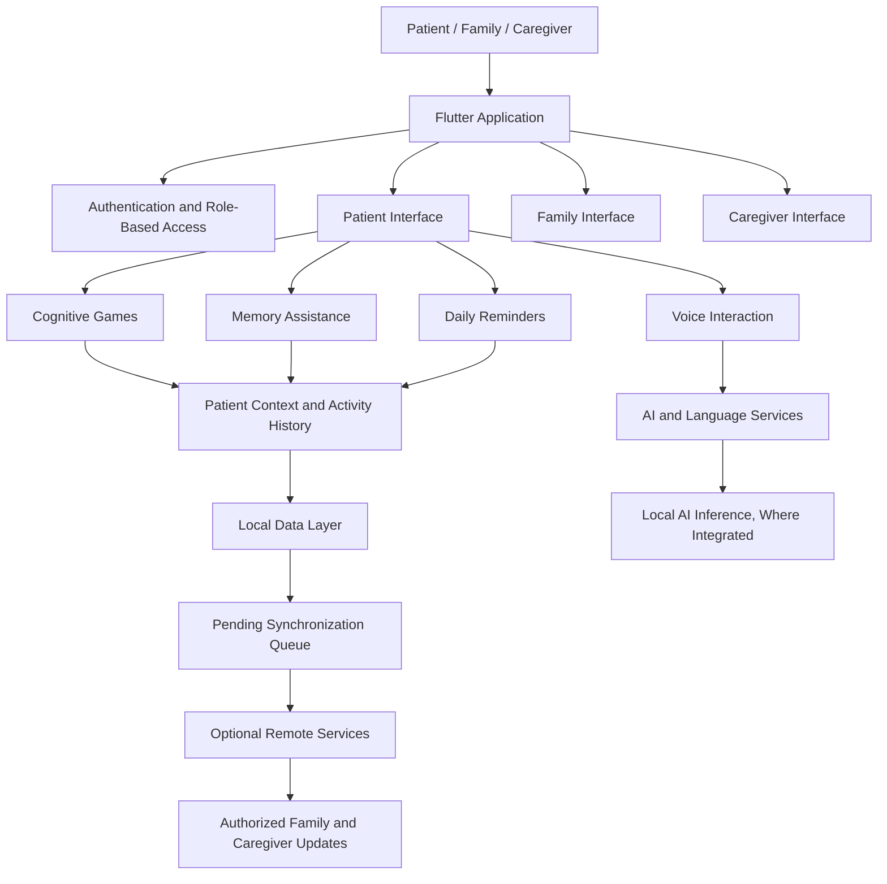
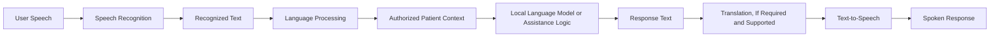
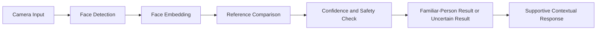
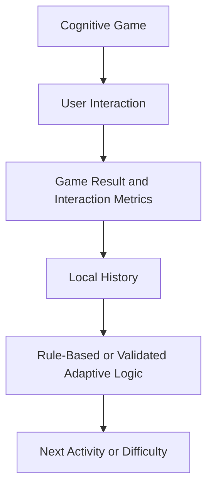
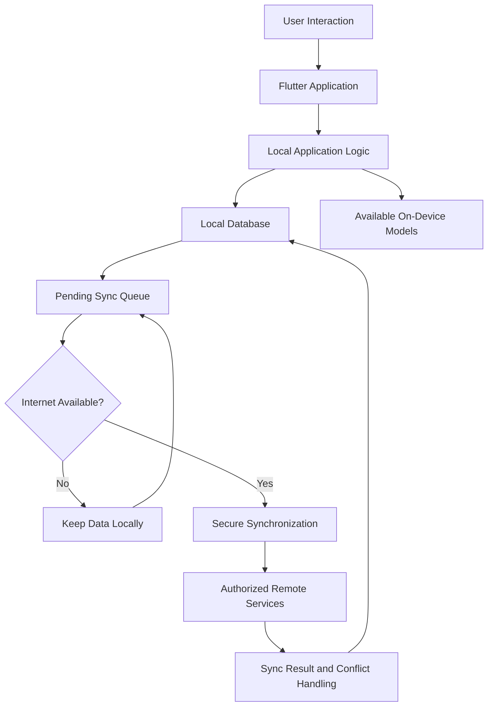

<div align="center">

# SMARAN
### Multimodal AI Platform for Cognitive & Elderly Care


<p>
  <strong>An offline-first, AI-powered cognitive assistance and memory support platform designed for older adults living with dementia or cognitive impairment, with a focus on the North Eastern Region (NER) of India.</strong>
</p>

<p>
  
  
  
  
</p>

**Built with empathy. Designed for accessibility. Focused on dignity.**

</div>

---

## 📌 At A Glance

| Field | Details |
|---|---|
| **Project Name** | SMARAN ~ Multimodal AI Platform for Cognitive & Elderly Care |
| **PS ID** | SIH26003 |
| **Problem Statement Title** | AI-Based Cognitive Gaming and Memory Assistance Platform for Elderly Dementia Patients in North Eastern Region (NER) |
| **Organization** | Ministry of Development of North Eastern Region (MDoNER) |
| **Department** | 	Ministry of Development of North Eastern Region (MDoNER) |
| **Project Category** | Software |
| **Theme** | MedTech / BioTech / HealthTech |
| **Team ID** | 149420 |
| **Team Name** | Asymptotics |

---

## 📖 Table of Contents

- [1. Overview](#-1-overview)
- [2. Problem Statement](#-2-problem-statement)
- [3. Our Solution](#-3-our-solution)
- [4. Core Features](#-4-core-features)
- [5. System Architecture](#-5-system-architecture)
- [6. Multimodal AI Pipeline](#-6-multimodal-ai-pipeline)
- [7. Technical Implementation](#-7-technical-implementation)
- [8. Offline-First Architecture](#-8-offline-first-architecture)
- [9. User Roles and Workflows](#-9-user-roles-and-workflows)
- [10. Privacy, Safety, and Accessibility](#-10-privacy-safety-and-accessibility)
- [11. Technology Stack](#-11-technology-stack)
- [12. Repository Structure](#-12-repository-structure)
- [13. Getting Started](#-13-getting-started)
- [14. Implementation Status](#-14-implementation-status)
- [15. Future Scope](#-15-future-scope)
- [16. Responsible Use Disclaimer](#-16-responsible-use-disclaimer)
- [17. Research and References](#-17-research-and-references)
- [18. Demonstration Links](#-18-demonstration-links)

---

## 🌿 1. Overview

**SMARAN** is an offline-first, AI-powered cognitive assistance and memory support platform proposed for older adults living with dementia or cognitive impairment, particularly in the North Eastern Region (NER) of India.

The platform brings together cognitive games, personalized memory assistance, multilingual voice interaction, daily routine reminders, and caregiver-family connectivity in a unified application.

SMARAN is guided by a simple principle:

> **Technology in Service of Dignity.**

Rather than treating cognitive assistance as a clinical task alone, SMARAN aims to make everyday interactions more familiar, supportive, accessible, and reassuring for older adults.

The long-term product vision brings together five connected capabilities:

1. **Adaptive Cognitive Engagement** — accessible activities for memory, recall, attention, and pattern recognition.
2. **Multilingual Voice Assistance** — voice-led interaction in supported languages.
3. **Family Memory Assistance** — familiar people, photographs, relationships, and personal memories.
4. **Smart Daily Assistance** — reminders for routines and everyday tasks.
5. **Family and Caregiver Connectivity** — understandable updates for authorized support networks.

The long-term goal is to make essential patient-facing functionality available locally wherever technically possible, while protecting personal information and handling connectivity limitations transparently.

> **Implementation note:** This README describes both the current application project and the broader proposed architecture. A feature described as planned or proposed should not be assumed to be implemented, tested, or clinically validated.

---

## 🎯 2. Problem Statement

### Problem Statement ID: SIH26003

**AI-Based Cognitive Gaming and Memory Assistance Platform for Elderly Dementia Patients in the North Eastern Region (NER)**

### The Challenge

People living with dementia or cognitive impairment may experience difficulties with memory, recognition, attention, communication, and everyday activities. These changes can also affect family members and caregivers, who may need to provide frequent reminders, reassurance, supervision, and routine support.

In parts of the North Eastern Region, access to suitable digital support may also be affected by regional-language needs, differences in digital familiarity, device limitations, and unreliable internet connectivity.

A useful support platform must therefore consider more than artificial intelligence alone. It must also address usability, accessibility, privacy, local context, and caregiver needs.

### Key Challenges Addressed

- **Memory and recall:** remembering people, events, and familiar information can become difficult.
- **Cognitive engagement:** activities need to be accessible, adjustable, and encouraging.
- **Communication barriers:** users may prefer to interact in familiar regional languages.
- **Daily routine management:** medication schedules, hydration, appointments, and other tasks may require reminders.
- **Family connection:** familiar faces, names, relationships, and personal memories can provide helpful context.
- **Caregiver coordination:** authorized supporters may need understandable updates about activity and reminders.
- **Connectivity limitations:** essential local functions should not unnecessarily depend on a continuous internet connection.

### Objective

To develop a unified cognitive assistance and memory support platform that combines accessible cognitive activities, personalized assistance, multilingual interaction, daily reminders, and caregiver-family support, with offline-first operation as a core design goal.

---

## 💡 3. Our Solution

SMARAN proposes an integrated platform connecting cognitive engagement, memory assistance, voice interaction, and everyday care. The design centers on the relationship between the person using the application, their personal context, and the people supporting them.

### The SMARAN Approach

| Capability | What It Does | Intended Benefit |
|---|---|---|
| Adaptive Cognitive Engagement | Provides memory, recall, attention, and pattern-recognition activities | Encourages regular cognitive engagement |
| Multilingual Voice Assistance | Supports voice-based interaction in languages supported by the integrated models | Makes interaction more accessible |
| Family Memory Assistance | Organizes familiar people, relationships, photographs, and personal memories | Provides familiar contextual cues |
| Smart Daily Assistance | Organizes reminders for medication, hydration, and daily tasks | Supports routine management |
| Family and Caregiver Connectivity | Presents relevant patient updates and activity summaries to authorized supporters | Helps coordinate care and support |

These capabilities are intended to share relevant patient context through a local-first data architecture, with appropriate access controls.

**Design principle:** SMARAN should support the person, not judge them. Cognitive activities and reminders should be encouraging, understandable, and respectful.

---

## 🧠 4. Core Features

### 4.1 Adaptive Cognitive Engagement

SMARAN proposes a collection of cognitive games and activities intended to engage different cognitive skills.

**Planned capabilities:**

- Memory and recall activities.
- Attention and pattern-recognition challenges.
- Configurable or adaptive difficulty.
- Game-result recording.
- Activity-history tracking.
- Activity selection based on prior interactions, where suitable and validated.

The intended approach is to choose activities that suit a person's interaction history instead of relying only on one fixed difficulty level.

**Important:** Game performance is an interaction measure, not a standalone medical diagnosis or proof of cognitive decline.

### 4.2 Multilingual Voice Assistance

Voice interaction is intended to make SMARAN easier to use for people who may find conventional text-heavy interfaces difficult.

**Planned capabilities:**

- Speech-to-text processing.
- Regional-language interaction.
- Language identification and response processing.
- Text-to-speech responses.
- Context-aware conversational assistance.
- Voice-guided reminders and navigation.

Potential language coverage includes Assamese, Bengali, Bodo, English, Garo, Hindi, Khasi, Kokborok, Meitei/Manipuri, Mizo, Nagamese, and Nepali. Actual support depends on the availability, quality, licensing, integration, and on-device performance of the selected models.

The application should handle uncertain speech recognition gracefully and ask for clarification rather than confidently responding to misunderstood speech.

### 4.3 Family Memory Assistance

Familiar people and personal memories may provide useful contextual cues during everyday interactions.

Potential capabilities include:

- Family-member photographs.
- Names and relationships.
- Familiar-person recognition, if safely implemented.
- Personal memory notes and contextual information.
- Family-provided details.
- Familiar visual cues to support memory assistance.

The experience should help users reconnect with familiar people and information without shaming them when they do not recognize something.

Facial recognition, where implemented, must use appropriate consent, safeguards, and controls for sensitive biometric data. Recognition results should be treated as uncertain when confidence is low.

### 4.4 Smart Daily Assistance

SMARAN proposes a daily assistance system to help people maintain familiar routines.

**Planned capabilities:**

- Medication reminders.
- Hydration reminders.
- Daily activity reminders.
- Appointment reminders.
- Missed-task tracking.
- Local notifications.
- Optional voice reminders.

Reminders should be clear, calm, and accessible. Medication schedules and other important instructions should be configured or verified by the patient, an authorized caregiver, or an appropriate healthcare professional. The platform must not independently prescribe or change medication.

### 4.5 Family and Caregiver Connectivity

SMARAN proposes separate, role-appropriate interfaces for patients, family members, caregivers, and healthcare professionals where relevant workflows are implemented.

Potential capabilities include:

- Patient activity summaries.
- Reminder completion and missed-reminder updates.
- Cognitive-game history.
- Activity and progress trends.
- Important notifications.
- Family information and contextual notes.
- Caregiver reports and summaries.
- Communication between authorized users.

The aim is to present meaningful information that helps caregivers understand when assistance may be needed without overwhelming them with unexplained charts or raw data.

### 4.6 Patient Context and Memory Bank

A shared patient context can connect relevant information from reminders, games, memories, and interactions.

Depending on the implemented features, this context may include:

- Patient preferences.
- Familiar people and relationships.
- Personal memory notes.
- Daily activity history.
- Game results.
- Reminder history.
- Caregiver-provided information.

Access should be limited to authorized users and follow appropriate privacy, retention, and deletion practices.

---

## 🏗️ 5. System Architecture

SMARAN is designed around a Flutter/Dart application, local data storage, modular assistance services, and optional synchronization. The proposed architecture separates user interaction, application features, local persistence, AI processing, and remote services.

### 5.1 High-Level Architecture



### 5.2 Architectural Components

| Component | Responsibility |
|---|---|
| Flutter Application | Provides the cross-platform user interface |
| Authentication Layer | Manages access and role-specific workflows |
| Cognitive Gaming Module | Runs cognitive activities and records results |
| Memory Assistance Module | Organizes familiar people and personal context |
| Reminder Module | Manages daily tasks and reminder schedules |
| Voice Interaction Module | Coordinates speech input, language processing, and spoken output |
| AI Services | Provide selected local inference or assistance capabilities |
| Local Data Layer | Stores eligible application information on the device |
| Synchronization Layer | Queues and transfers eligible information when connectivity permits |
| Caregiver Interface | Presents relevant patient information and updates |

The exact division between on-device and remote services depends on the selected models, device capabilities, and completed integrations.

### 5.3 Intended User Roles

- **Patient:** cognitive activities, memory assistance, orientation, and reminders.
- **Family Member:** family information, memories, updates, and authorized support.
- **Caregiver:** routine management, patient monitoring, reminders, and relevant alerts.
- **Doctor or Healthcare Professional:** clinical review or reporting capabilities if an appropriate workflow is implemented.

Not every role or feature should be assumed to be fully implemented merely because it appears in the proposed architecture.

---

## 🗣️ 6. Multimodal AI Pipeline

SMARAN proposes a modular AI pipeline for multilingual interaction, personalized responses, visual recognition, and cognitive-activity analysis. Each component must be evaluated for compatibility, privacy, latency, reliability, and performance on supported devices.

### 6.1 Voice and Language Pipeline



The proposed workflow is:

1. Capture the user's spoken input, with appropriate permissions.
2. Convert speech into text using a supported speech-recognition system.
3. Identify the language and process the recognized text.
4. Use relevant, authorized patient context where appropriate.
5. Generate a response using the selected language model or assistance logic.
6. Translate the response when required and supported.
7. Convert the response into speech where supported.

The application should not present uncertain recognition or generated content as guaranteed fact. It should provide clarification and safe fallback behavior when confidence is insufficient.

### 6.2 Proposed Language Technologies

| Function | Proposed Technology | Intended Role |
|---|---|---|
| Speech Recognition | AI4Bharat IndicConformer | Regional-language speech recognition |
| Language Translation | IndicTrans2 | Translation between supported languages |
| Text Generation | Qwen 1.5B, quantized to 4-bit (Q4) | Potential local language-model inference, subject to device constraints |
| Model Runtime | `llama.cpp` | Potential runtime for compatible model formats |
| Model Interoperability | ONNX Runtime | Execution of compatible ONNX models |
| Text-to-Speech | AI4Bharat IndicTTS2 | Regional-language speech generation |

These are proposed components. Listing a technology does not mean that it has already been integrated into the Flutter application.

### 6.3 Face Recognition and Family Memory



The proposed face-recognition workflow may use MediaPipe for face detection and a compatible face-embedding model, such as an appropriate ArcFace-based implementation.

A recognition result should not be treated as certain when confidence is low. The interface should offer a respectful fallback, such as asking the user or caregiver to confirm the person's identity. Biometric processing requires appropriate consent, data protection, and deletion controls.

### 6.4 Cognitive Gaming and Activity Adaptation



The proposed system may use game results and interaction history to select suitable activities or adjust difficulty. Any adaptive mechanism should be tested for consistency, accessibility, and unintended bias. Interaction metrics must not be represented as validated clinical assessments unless the necessary validation has been completed.

### 6.5 AI as an Assistance Layer

The AI component is intended to support contextual assistance, personalized interactions, and coordination between modules. It must not replace professional medical judgment, make unsupported diagnostic claims, or independently alter prescribed treatment.

---

## ⚙️ 7. Technical Implementation

This section describes the proposed implementation approach. Feature availability depends on the source code, configured dependencies, device support, and completed tests.

### 7.1 Cognitive Gaming Engine

**Proposed technologies:** Flutter, Dart, and Flame.

Responsibilities may include:

- Rendering game interfaces.
- Processing user interactions.
- Applying game rules.
- Recording scores and activity results.
- Providing accessible feedback.
- Supporting configurable difficulty.

### 7.2 Patient Context and Activity Summaries

The application may record structured information about completed activities and reminders. Potential measures include:

- Number of activities completed.
- Game scores and attempts.
- Reminder completion history.
- Activity frequency.
- Changes in interaction patterns.

These measures should be interpreted cautiously. Changes can result from fatigue, distraction, environmental conditions, interface difficulty, temporary illness, or other factors.

### 7.3 Touch and Interaction Dynamics

Interaction timing and touch-event patterns may help identify when a user is having difficulty with the interface. If implemented, these data should be treated as optional usability signals rather than diagnostic tools. The application should not make medical conclusions from isolated touch errors, typing patterns, or slower interactions.

### 7.4 Task and Reminder System

The proposed reminder workflow is:

1. A patient or authorized caregiver configures a task.
2. The application stores the schedule locally where supported.
3. The platform scheduling mechanism triggers a notification.
4. The user receives a clear reminder.
5. The application records the response or completion state, where supported.
6. Authorized caregivers may receive updates when the relevant synchronization mechanism is available.

Potential technologies include Flutter-compatible local notification packages and platform-specific scheduling facilities such as Android WorkManager. Platform restrictions, permissions, battery management, device settings, and scheduling behavior must be tested on supported devices.

### 7.5 Local Data Storage

The proposed data layer may use:

- **SQLite** for structured local data.
- **Drift** as a typed database abstraction for Dart.
- **SQLCipher or another suitable encryption approach** for encrypted database storage, if integrated and correctly configured.

Database encryption requires correct configuration and secure key management. Using a database library alone does not guarantee that all application data is encrypted.

---

## 📡 8. Offline-First Architecture

Offline-first operation is a central design goal of SMARAN. The application should keep essential patient-facing functionality available without requiring continuous internet access wherever the feature and its dependencies support offline execution.

### 8.1 How Offline-First Operation Works



### 8.2 Offline-First Principles

- **Local availability:** keep essential functions available locally when technically possible.
- **Local persistence:** store eligible application data on the device.
- **Deferred synchronization:** queue eligible updates when connectivity is unavailable.
- **Controlled transfer:** transfer only the data required by the selected synchronization workflow.
- **Error handling:** handle interrupted transfers and retry failures safely.
- **Conflict management:** define how local and remote changes are reconciled.
- **User clarity:** do not imply that remote alerts have been delivered when synchronization has not occurred.

### 8.3 Important Offline Limitations

Offline-first does not mean every feature automatically works without internet access. Some functions may require a network connection, model downloads, remote services, or compatible device hardware.

- Local reminders may work offline after correct configuration and permission setup.
- Local AI inference requires a model and runtime installed and supported on the device.
- Remote caregiver notifications may be delayed while the patient device is offline.
- Initial account verification or cloud synchronization may require connectivity.
- Model quality, memory use, and response speed depend on device resources.

The application should communicate these limitations clearly.

---

## 🔐 9. User Roles and Workflows

### 9.1 Patient Workflow

The patient-facing experience is intended to prioritize simplicity and reassurance.

A potential workflow is:

1. Open the application.
2. View the home screen and orientation information, if available.
3. Access cognitive games, memories, reminders, or voice assistance.
4. Receive clear guidance and encouraging feedback.
5. Complete an activity or acknowledge a reminder.
6. Continue using available local features when offline.

The interface should avoid unnecessary navigation complexity and support older adults with different levels of digital familiarity.

### 9.2 Family Member Workflow

The family-facing experience may allow authorized family members to:

- Add familiar-person information and personal memories.
- Review relevant updates.
- Share contextual information with caregivers.
- Help maintain accurate patient preferences and relationships.
- Provide support through approved communication features.

Access should be restricted to information that the family member is authorized to view or change.

### 9.3 Caregiver Workflow

The caregiver interface is intended to organize relevant patient information into an actionable overview.

Potential capabilities include:

- Patient status and recent activity.
- Reminder completion and missed tasks.
- Cognitive-game history.
- Important alerts.
- Patient routine management.
- Progress summaries and reports.
- Communication and support coordination.

A caregiver dashboard should emphasize understandable information and practical next steps instead of overwhelming users with unexplained metrics.

### 9.4 Healthcare Professional Workflow

A future or separately implemented professional workflow may support:

- Review of relevant patient information.
- Longitudinal activity summaries.
- Caregiver-provided observations.
- Structured reports.
- Appropriate clinical-system integration.

Any clinical workflow must define its intended use, access permissions, validation requirements, and limitations before use in a healthcare setting.

---

## ♿ 10. Privacy, Safety, and Accessibility

SMARAN is intended for a sensitive use case involving older adults and personal health-related information. Privacy and usability must therefore be treated as core design requirements.

### 10.1 Privacy and Data Protection

The proposed design principles include:

- Collect only the information needed for the selected functionality.
- Restrict access according to user roles.
- Protect locally stored sensitive information.
- Use secure communication for remote data transfer.
- Manage authentication credentials and encryption keys securely.
- Obtain appropriate consent for photographs and biometric processing.
- Provide clear controls for managing personal information.
- Define retention and deletion procedures.
- Avoid exposing sensitive information in logs or error messages.
- Use synthetic data for public demos, fixtures, and screenshots wherever practical.

Implementation should be reviewed against applicable Indian data-protection requirements and other relevant regulations.

### 10.2 Dementia-Friendly User Experience

The interface should prioritize:

- Large, readable text.
- High contrast.
- Large touch targets.
- Clear icons accompanied by understandable labels.
- Simple navigation and predictable layouts.
- Familiar visual cues.
- Calm colors and restrained animation.
- Encouraging, non-judgmental feedback.
- Clear confirmation before consequential actions.
- Accessible error recovery.

The intended interaction style should reduce confusion and preserve dignity. Accessibility claims should be tested against relevant guidelines and with appropriate users rather than inferred from visual design alone.

### 10.3 Responsible AI

AI-assisted features should:

- Communicate uncertainty when appropriate.
- Avoid presenting guesses as facts.
- Use only relevant and authorized personal context.
- Provide safe fallback behavior.
- Avoid unsupported medical diagnoses.
- Avoid independently changing medication or treatment instructions.
- Allow human confirmation for important actions.
- Be tested across supported languages and realistic usage conditions.

### 10.4 Caregiver Alerts

Potential alerts should prompt human review rather than present definitive medical conclusions. For example, a sudden change in behavior may justify caregiver attention, but the application should not claim that a particular medical condition is present without appropriate clinical evaluation.

---

## 🧰 11. Technology Stack

The table below summarizes the **proposed** technology stack. These entries describe the target architecture and should not be interpreted as confirmation that every component is integrated into the current application.

| Layer | Technology | Intended Purpose |
|---|---|---|
| Application UI | Flutter | Cross-platform user interface |
| Programming Language | Dart | Application logic |
| Cognitive Gaming | Flame | Game rendering and interaction |
| Local AI Inference | Qwen 1.5B Q4 / `llama.cpp` | Potential on-device language-model processing |
| Speech Recognition | AI4Bharat IndicConformer | Regional-language speech recognition |
| Language Translation | IndicTrans2 | Translation for supported languages |
| Text-to-Speech | AI4Bharat IndicTTS2 | Spoken responses |
| Model Execution | ONNX Runtime | Execution of compatible models |
| Face Processing | MediaPipe / compatible face-embedding model | Face detection and recognition pipeline |
| Local Database | SQLite | Structured local persistence |
| Database Abstraction | Drift | Typed database access |
| Database Encryption | SQLCipher or equivalent | Encrypted local database storage, if integrated and correctly configured |
| Background Scheduling | WorkManager / platform scheduling | Eligible background tasks and reminders |
| Synchronization | REST API / JSON / local queue | Optional remote synchronization |
| Analytics | Custom application logic | Activity and interaction summaries |

**Technology status:** Verify package compatibility, model availability, supported model formats, platform support, licensing, privacy implications, and actual code integration before describing a component as implemented or production-ready.

---

## 📂 12. Repository Structure

The repository contains the Flutter/Dart application and supporting project resources. The following tree is a high-level guide; it is not an exhaustive listing of every file.

```text
SMARAN_Asymptotics_SIH26003/
├── .gitignore
├── .pre-commit-config.yaml
├── CHANGELOG.md
├── LICENSE
├── README.md
├── memory.json
├── mkdocs.yml
├── pyproject.toml
├── smaran-logo.png
├── uv.lock
├── SIH_Project/
│   ├── game/
│   ├── landing/
│   └── memory_game.db
└── Smaran(Flutter-Dart)/
    ├── android/
    ├── android_native/
    ├── assets/
    ├── backup/
    ├── ios/
    ├── lib/
    ├── linux/
    ├── macos/
    ├── test/
    ├── web/
    ├── windows/
    ├── analysis_options.yaml
    ├── pubspec.yaml
    └── pubspec.lock
```

Some files or directories may change as the project evolves. Confirm the current repository before relying on this tree as a complete inventory.

### Important Flutter Project Files

| File or Directory | Purpose |
|---|---|
| `Smaran(Flutter-Dart)/lib/` | Flutter and Dart application source code |
| `Smaran(Flutter-Dart)/assets/` | Images, icons, audio, models, and other bundled resources |
| `Smaran(Flutter-Dart)/android/` | Android platform configuration |
| `Smaran(Flutter-Dart)/ios/` | iOS platform configuration |
| `Smaran(Flutter-Dart)/web/` | Web platform configuration |
| `Smaran(Flutter-Dart)/windows/` | Windows platform configuration |
| `Smaran(Flutter-Dart)/linux/` | Linux platform configuration |
| `Smaran(Flutter-Dart)/macos/` | macOS platform configuration |
| `Smaran(Flutter-Dart)/test/` | Automated tests, where present |
| `Smaran(Flutter-Dart)/pubspec.yaml` | Package dependencies and asset configuration |
| `Smaran(Flutter-Dart)/pubspec.lock` | Resolved Dart and Flutter dependencies |
| `SIH_Project/` | Supporting project resources, including game and landing-page materials |
| `smaran-logo.png` | Repository logo used in this README |

**Repository hygiene:** Generated build output and temporary caches should generally not be committed. Before publishing, review `memory.json` and `SIH_Project/memory_game.db` to ensure they contain only synthetic or otherwise appropriate public demo data—never real patient information, credentials, or secrets.

---

## 🚀 13. Getting Started

These instructions describe the typical Flutter development workflow. Exact setup requirements may vary by platform and by the current state of the project.

### Prerequisites

Install and configure:

- Git.
- Flutter SDK (Dart is included with Flutter).
- Android Studio or another supported development environment.
- Android SDK and required platform tools for Android development.
- A supported device or emulator.

Verify the environment:

```bash
flutter doctor
```

### Step 1: Clone the Team Repository

```bash
git clone https://github.com/PRITAMADAK11052004/SMARAN_Asymptotics_SIH26003.git
```

### Step 2: Enter the Repository

```bash
cd SMARAN_Asymptotics_SIH26003
```

### Step 3: Open the Flutter Application Directory

```bash
cd "Smaran(Flutter-Dart)"
```

### Step 4: Retrieve Dependencies

```bash
flutter pub get
```

### Step 5: Check Available Devices

```bash
flutter devices
```

### Step 6: Run the Application

```bash
flutter run
```

### Step 7: Run Static Analysis

```bash
flutter analyze
```

### Step 8: Run Automated Tests

```bash
flutter test
```

Run analysis and tests before submitting changes. Automated tests should cover critical workflows such as authentication, reminders, local persistence, role-based access, and offline behavior as those features are implemented.

### Troubleshooting

If generated Flutter build files or dependency artifacts become inconsistent, try:

```bash
flutter clean
flutter pub get
```

Then try running the application again:

```bash
flutter run
```

`flutter clean` removes generated build artifacts and may require a longer rebuild. It does not replace diagnosing platform-specific dependency, SDK, or configuration errors.

---

## 📊 14. Implementation Status

SMARAN combines an existing Flutter application codebase with a broader proposed architecture. The status of individual capabilities should be maintained against the current source code and verified behavior. The table below is a **verification checklist**, not a claim that all features are complete.

| Capability | Status to Confirm |
|---|---|
| Flutter/Dart application | Application source is included in the repository; verify current build and run behavior |
| Patient, family, and caregiver workflows | Verify each flow, permissions, and persistence |
| Cognitive games | Verify each game implementation and interaction handling |
| Adaptive difficulty | Verify adaptation logic and testing |
| Family memory assistance | Verify the data model, UI, and authorization |
| Face recognition | Verify model integration, consent, and on-device operation |
| Multilingual voice input | Verify supported languages and runtime behavior |
| Language translation | Verify model integration and language coverage |
| Text-to-speech | Verify supported languages and offline operation |
| Local reminders | Verify scheduling, permissions, and reliability on target devices |
| Local database | Verify schema, persistence, and encryption configuration |
| Offline synchronization | Verify queuing, retry, conflict handling, and security |
| Caregiver dashboard | Verify data flow, calculations, and available reports |
| Healthcare-system integration | Verify separately; do not assume availability |

Update this table as each feature is implemented and validated. Mark a feature complete only when its code, dependencies, configuration, and expected behavior have been checked. If useful, replace the status column with explicit `Implemented`, `In Progress`, `Planned`, or `Not Yet Verified` states that the team can substantiate.

---

## 🔭 15. Future Scope

Potential future development areas include the following, subject to technical feasibility, validation, and project priorities.

### 15.1 Expanded Regional-Language Support

Improve recognition, translation, and spoken-response quality for languages used across the North Eastern Region. Measure actual performance in supported languages rather than assuming equal quality across them.

### 15.2 Improved On-Device AI

Optimize compatible models for memory usage, inference speed, battery consumption, and operation on affordable Android devices.

### 15.3 Personalized Cognitive Activities

Explore appropriate approaches for selecting activities based on user preferences, accessibility needs, and interaction history. Any claims about cognitive outcomes require suitable evaluation.

### 15.4 Richer Family Memory Experiences

Extend personal memory collections with photographs, names, relationships, stories, and optional voice recordings, subject to appropriate permissions and privacy controls.

### 15.5 Caregiver Reports

Provide clear, privacy-conscious summaries of activities, reminders, and changes that caregivers may need to review.

### 15.6 Improved Offline Synchronization

Develop robust retry behavior, conflict resolution, secure transfer, and clear synchronization status.

### 15.7 Clinical and Healthcare Integration

Explore appropriate integration with healthcare systems, subject to technical compatibility, permissions, applicable standards, and regulatory requirements.

### 15.8 Validation and Evaluation

Evaluate usability, accessibility, language quality, reliability, privacy, and safety with appropriate participants and oversight before making claims about clinical benefit.

---

## ⚠️ 16. Responsible Use Disclaimer

SMARAN is intended to support cognitive engagement, memory assistance, daily routines, and coordination between patients and their authorized support networks.

**SMARAN is not a replacement for professional medical advice, diagnosis, treatment, or emergency services.**

Cognitive-game scores, interaction patterns, facial-recognition results, and AI-generated responses must not be treated as definitive medical conclusions. Medication schedules and other clinically important instructions should be verified by an appropriate healthcare professional or authorized caregiver.

Any clinical deployment requires appropriate evaluation, privacy safeguards, security testing, accessibility review, and compliance with applicable requirements. This README does not claim that SMARAN is a certified medical device or clinically validated system.

---

## 📚 17. Research and References

The following publications provide background for digital cognitive assessment, smartphone interaction measures, cognitive control, and attention. They are **research context**, not evidence that SMARAN itself is clinically validated or effective.

1. **Digital Cognitive Biomarker for Mild Cognitive Impairments and Dementia: A Systematic Review**  
   Reviews computerized cognitive tests and potential digital biomarkers studied in relation to mild cognitive impairment (MCI) and dementia.  
   [Read the paper — Journal of Clinical Medicine (2022)](https://pmc.ncbi.nlm.nih.gov/articles/PMC9320101/)

2. **Diagnostic Accuracy of Keystroke Dynamics as Digital Biomarkers for Fine Motor Decline in Neuropsychiatric Disorders: A Systematic Review and Meta-Analysis**  
   Reviews evidence on keystroke dynamics as potential digital biomarkers for fine-motor decline across neuropsychiatric conditions. The authors note that additional evidence is needed.  
   [Read the paper — Scientific Reports (2022)](https://www.nature.com/articles/s41598-022-11865-7)

3. **Detection of Mild Cognitive Impairment Through Natural Language and Touchscreen Typing Processing**  
   Examines natural-language features and touchscreen typing measures in a small study distinguishing participants with MCI from healthy controls. Its findings should not be generalized beyond the study design without further evidence.  
   [Read the paper — Frontiers in Digital Health (2020)](https://www.frontiersin.org/journals/digital-health/articles/10.3389/fdgth.2020.567158/full)

4. **Discriminant Power of Smartphone-Derived Keystroke Dynamics for Mild Cognitive Impairment Compared to a Neuropsychological Screening Test: Cross-Sectional Study**  
   Examines smartphone-derived keystroke measures in a cross-sectional study. The article has a published correction notice, which should be consulted when interpreting its findings.  
   [Read the corrected article — Journal of Medical Internet Research (2024)](https://www.jmir.org/2024/1/e59247) · [Correction notice (2025)](https://www.jmir.org/2025/1/e86291)

5. **Cognitive Control**  
   Reviews how cognitive control supports context-sensitive behavior and monitoring or adjustment of ongoing behavior.  
   [Read the paper — Annual Review of Psychology (2025)](https://doi.org/10.1146/annurev-psych-022024-103901)

6. **An Information Theory Account of Cognitive Control**  
   Presents a theoretical account connecting cognitive control, information processing, uncertainty, and related brain networks.  
   [Read the paper — Frontiers in Human Neuroscience (2014)](https://doi.org/10.3389/fnhum.2014.00680)

7. **The Attention System of the Human Brain**  
   Foundational review describing the human attention system.  
   [Read the paper — Annual Review of Neuroscience (1990)](https://doi.org/10.1146/annurev.ne.13.030190.000325)

**Research note:** These publications support general background discussion only. They do not establish the safety, effectiveness, diagnostic accuracy, or clinical benefit of SMARAN. Product-specific claims require evidence from testing and evaluation of SMARAN itself.

---

## 🔗 18. Demonstration Links

Explore the SMARAN project resources below. Availability may depend on the sharing settings of each external service.

- 🎥 **Demo Video Playlist:** [Watch on YouTube](https://youtube.com/playlist?list=PLcLUKOfNfoZo8csi-j2jon2amrOGonTki)
- 💻 **GitHub Repository:** [View the source code](https://github.com/PRITAMADAK11052004/SMARAN_Asymptotics_SIH26003)
- 🔬 **Research Drive:** [Open research materials](https://drive.google.com/drive/folders/1PssjNUIT3JfrLFRsKvZ5GLMw-7LTdwx)
- 🌐 **Web App:** [Visit the web demo](https://asymptotics.vercel.app/)
- 📱 **App Demo:** [View the app demonstration](https://drive.google.com/file/d/12pcJEIIEX31o_eIWZpi2civfenyrvXIM/view?usp=drivesdk)

---

<div align="center">

**Built with empathy. Designed for accessibility. Focused on dignity.**

*SMARAN — Technology in Service of Dignity.*

</div>
