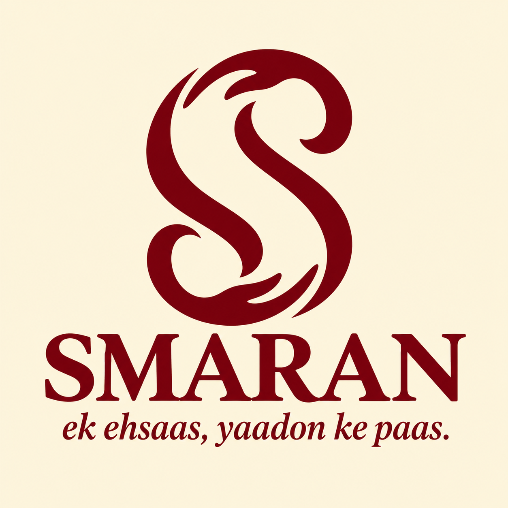
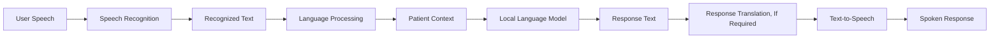
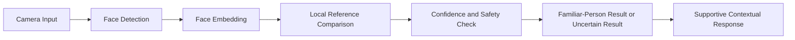
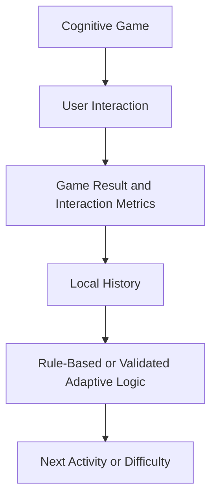
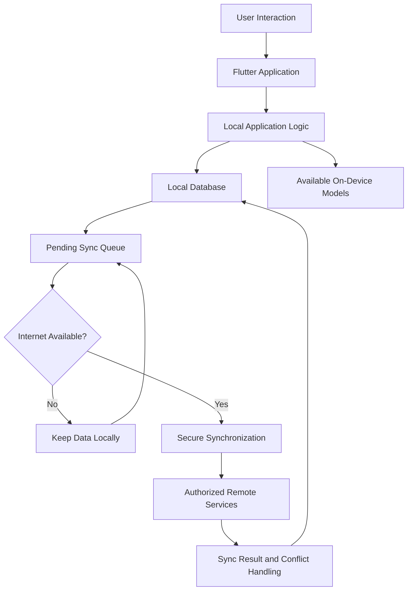

<div align="center">

# SMARAN
### Multimodal AI Platform for Cognitive & Elderly Care



<p>
  <strong>
    An offline-first, AI-powered cognitive assistance and memory support platform
    designed for elderly people living with dementia and cognitive impairment,
    with a focus on the North Eastern Region (NER) of India.
  </strong>
</p>

<p>
  
  
  
  
</p>

</div>

---

## 📌 At A Glance

| Field | Details |
|---|---|
| **Project Name** | SMARAN ~ Multimodal AI Platform for Cognitive & Elderly Care |
| **PS ID** | SIH26003 |
| **Problem Statement Title** | AI-Based Cognitive Gaming and Memory Assistance Platform for Elderly Dementia Patients in North Eastern Region (NER) |
| **Organization** | Ministry of Development of North Eastern Region (MDoNER) |
| **Department** | 	Ministry of Development of North Eastern Region (MDoNER) |
| **Project Category** | Software |
| **Theme** | MedTech / BioTech / HealthTech |
| **Team ID** | 149420 |
| **Team Name** | Asymptotics |

---

## 📖 Table of Contents

- [1. Overview](#-1-overview)
- [2. Problem Statement](#-2-problem-statement)
- [3. Our Solution](#-3-our-solution)
- [4. Core Features](#-4-core-features)
- [5. System Architecture](#-5-system-architecture)
- [6. Multimodal AI Pipeline](#-6-multimodal-ai-pipeline)
- [7. Technical Implementation](#-7-technical-implementation)
- [8. Offline-First Architecture](#-8-offline-first-architecture)
- [9. User Roles and Workflows](#-9-user-roles-and-workflows)
- [10. Privacy, Safety, and Accessibility](#-10-privacy-safety-and-accessibility)
- [11. Technology Stack](#-11-technology-stack)
- [12. Repository Structure](#-12-repository-structure)
- [13. Getting Started](#-13-getting-started)
- [14. Implementation Status](#-14-implementation-status)
- [15. Future Scope](#-15-future-scope)
- [16. Responsible Use Disclaimer](#-16-responsible-use-disclaimer)
- [17. Research & Referencesv](#-17-research-and-references)
- [18. Demonstration Links](#-18-demonstration-links)

---

## 🌿 1. Overview

**SMARAN** is a proposed offline-first, AI-powered cognitive assistance and memory support platform designed to support elderly people living with dementia and cognitive impairment, particularly in the North Eastern Region (NER) of India.

The platform brings together cognitive games, personalized memory assistance, multilingual voice interaction, daily routine reminders, and caregiver-family connectivity in a unified application.

SMARAN is guided by a simple principle:

> **Technology in Service of Dignity.**

Instead of treating cognitive assistance as a clinical task alone, SMARAN aims to make everyday interactions more familiar, supportive, accessible, and reassuring for older adults.

The platform is designed around five connected capabilities:

1. **Adaptive Cognitive Engagement**
2. **Multilingual Voice Assistance**
3. **Family Memory Assistance**
4. **Smart Daily Assistance**
5. **Family and Caregiver Connectivity**

The long-term vision is to combine these capabilities into a privacy-conscious system that can provide useful assistance even when reliable internet connectivity is unavailable.

---

## 🎯 2. Problem Statement

### Problem Statement ID: SIH26003

**AI-Based Cognitive Gaming and Memory Assistance Platform for Elderly Dementia Patients in North Eastern Region (NER)**

### The Challenge

People living with dementia or cognitive impairment may experience difficulties with memory, recognition, attention, communication, and everyday activities.

These difficulties can also affect family members and caregivers, who may need to provide frequent reminders, reassurance, supervision, and assistance with daily routines.

For communities in the North Eastern Region, accessibility, regional-language interaction, and unreliable connectivity can create additional challenges when using technology-based support systems.

A useful platform must therefore consider more than artificial intelligence alone. It must also consider usability, accessibility, privacy, local context, and the needs of caregivers.

### Key Challenges Addressed

- **Memory and recall:** Difficulty remembering people, events, and familiar information.
- **Cognitive engagement:** The need for accessible activities that encourage memory, attention, and pattern recognition.
- **Communication barriers:** The need for interaction in familiar regional languages.
- **Daily routine management:** Difficulty remembering medication schedules, hydration, appointments, and everyday tasks.
- **Family connection:** The importance of familiar faces, names, relationships, and personal memories.
- **Caregiver coordination:** The need for meaningful updates about activities, reminders, and changes that may require attention.
- **Connectivity limitations:** The need for useful local functionality when internet access is unavailable.

### Our Objective

To develop a unified cognitive assistance and memory support platform that combines accessible cognitive activities, personalized assistance, multilingual interaction, daily reminders, and caregiver-family support, with offline-first operation as a core design goal.

---

## 💡 3. Our Solution

SMARAN proposes an integrated platform that connects cognitive engagement, memory assistance, voice interaction, and everyday care.

Rather than relying on one isolated feature, the platform is designed around the relationship between the patient, their personal context, and the people supporting them.

### The SMARAN Approach

| Capability | What It Does | Intended Benefit |
|---|---|---|
| Adaptive Cognitive Engagement | Provides memory, recall, attention, and pattern-recognition activities | Encourages regular cognitive engagement |
| Multilingual Voice Assistance | Supports voice-based interaction and regional-language workflows | Makes interaction more accessible |
| Family Memory Assistance | Connects familiar people, relationships, photographs, and personal memories | Provides familiar contextual cues |
| Smart Daily Assistance | Organizes reminders for medication, hydration, and daily tasks | Supports routine adherence |
| Family and Caregiver Connectivity | Provides patient updates, progress information, and important alerts | Helps coordinate support |

These capabilities are intended to work together through a shared patient context and a local-first data architecture.

**Design principle:** SMARAN should support the person, not judge them. Cognitive activities and reminders should be encouraging, understandable, and respectful.

---

## 🧠 4. Core Features

### 4.1 Adaptive Cognitive Engagement

SMARAN proposes a collection of cognitive games and activities intended to exercise different cognitive skills.

**Planned capabilities:**

- Memory and recall activities.
- Attention and pattern-recognition challenges.
- Personalized difficulty adjustment.
- Game-result recording.
- Performance-history tracking.
- Activity selection based on previous interactions.

The intended approach is to adapt the difficulty of activities to the individual's interaction history rather than relying on a single fixed difficulty level.

**Important:** Game performance should be treated as an interaction measure, not as a standalone medical diagnosis or proof of cognitive decline.

### 4.2 Multilingual Voice Assistance

Voice interaction is intended to make SMARAN easier to use for people who may find conventional text-heavy interfaces difficult.

**Planned capabilities:**

- Speech-to-text processing.
- Regional-language interaction.
- Language-processing and response-generation workflows.
- Text-to-speech responses.
- Context-aware conversational assistance.
- Voice-guided reminders and navigation.

The platform prioritizes the linguistic needs of the North Eastern Region.

Potential language support includes Assamese, Bengali, Bodo, English, Garo, Hindi, Khasi, Kokborok, Meitei/Manipuri, Mizo, Nagamese, and Nepali.

Actual support will depend on the availability, quality, licensing, integration, and on-device performance of the selected speech and language models.

### 4.3 Family Memory Assistance

Familiar people and personal memories can provide useful contextual cues in everyday interactions.

SMARAN proposes a family memory system that may include:

- Family-member photographs.
- Names and relationships.
- Familiar-person recognition.
- Personal memories and contextual notes.
- Family-provided information.
- Memory reinforcement through familiar visual cues.

The intended experience is to help patients reconnect with familiar people and information in a supportive manner.

Facial recognition, where implemented, should operate with appropriate consent, safeguards, and controls for sensitive biometric data.

### 4.4 Smart Daily Assistance

SMARAN proposes a daily assistance system to help users maintain familiar routines.

**Planned capabilities:**

- Medication reminders.
- Hydration reminders.
- Daily activity reminders.
- Appointment reminders.
- Missed-task tracking.
- Local notifications.
- Optional voice reminders.

Reminders should be clear, calm, and accessible.

Medication schedules and other important instructions should be configured or verified by the patient, caregiver, or appropriate healthcare professional. The platform should not independently prescribe or change medication.

### 4.5 Family and Caregiver Connectivity

SMARAN proposes separate interfaces for patients, family members, caregivers, and healthcare professionals where appropriate.

**Potential capabilities:**

- Patient activity monitoring.
- Reminder completion and missed-reminder updates.
- Cognitive-game history.
- Activity and progress trends.
- Important notifications.
- Family information and contextual notes.
- Caregiver reports and summaries.
- Communication between authorized users.

The aim is to present meaningful information that helps caregivers understand when assistance may be needed without overwhelming them with raw data.

### 4.6 Patient Context and Memory Bank

A shared patient context can help connect information from reminders, games, memories, and interactions.

Depending on implementation, this context may include:

- Patient preferences.
- Familiar people and relationships.
- Personal memory notes.
- Daily activity history.
- Game results.
- Reminder history.
- Caregiver-provided information.

Access to this information should be limited to authorized users and should follow appropriate privacy and data-retention practices.

---

## 🏗️ 5. System Architecture

SMARAN is designed around a Flutter/Dart application, local data storage, and modular assistance services.

The proposed architecture separates user interaction, application features, local persistence, AI processing, and optional synchronization.

### 5.1 High-Level Architecture


### 5.2 Architectural Components

| Component | Responsibility |
|---|---|
| Flutter Application | Provides the cross-platform user interface |
| Authentication Layer | Manages user access and role-specific workflows |
| Cognitive Gaming Module | Runs cognitive activities and records results |
| Memory Assistance Module | Organizes familiar people and personal context |
| Reminder Module | Manages daily tasks and reminder schedules |
| Voice Interaction Module | Coordinates speech input, language processing, and spoken output |
| AI Services | Provide selected local inference and assistance capabilities |
| Local Data Layer | Stores application information on the device |
| Synchronization Layer | Queues and transfers eligible information when connectivity permits |
| Caregiver Interface | Presents patient information and relevant updates |

The exact division between on-device and remote services depends on the selected models, device capabilities, and completed integrations.

### 5.3 Authentication and User Roles

The intended platform includes role-specific access for:

- **Patient:** Cognitive activities, memory assistance, orientation, and reminders.
- **Family Member:** Family information, memories, updates, and authorized support.
- **Caregiver:** Routine management, patient monitoring, reminders, and relevant alerts.
- **Doctor or Healthcare Professional:** Clinical review or reporting capabilities where an appropriate workflow is implemented.

Not every role or feature should be assumed to be fully implemented merely because it appears in the proposed architecture.

---

## 🗣️ 6. Multimodal AI Pipeline

SMARAN proposes a modular AI pipeline to support multilingual interaction, personalized responses, visual recognition, and cognitive activity analysis.

### 6.1 Voice and Language Pipeline



The proposed workflow is:

1. Capture the user's spoken input.
2. Convert speech into text using a supported speech-recognition system.
3. Identify the language and process the recognized text.
4. Use relevant, authorized patient context where appropriate.
5. Generate a response using the selected language model or assistance logic.
6. Translate the response when required and supported.
7. Convert the response into speech where supported.

The system should handle uncertain recognition gracefully and ask for clarification rather than confidently responding to misunderstood speech.

### 6.2 Proposed Language Technologies

| Function | Proposed Technology | Role |
|---|---|---|
| Speech Recognition | AI4Bharat IndicConformer | Regional-language speech recognition |
| Language Translation | IndicTrans2 | Translation between supported languages |
| Text Generation | Qwen 1.5B, quantized to 4-bit (Q4) | Local language-model inference, subject to device constraints |
| Model Runtime | llama.cpp | Potential runtime for supported GGUF models |
| Model Interoperability | ONNX Runtime | Execution of compatible models |
| Text-to-Speech | AI4Bharat IndicTTS2 | Regional-language speech generation |

These technologies are proposed components of the architecture. Their inclusion in this table does not, by itself, mean they have already been integrated into the Flutter application.

### 6.3 Face Recognition and Family Memory



The proposed face-recognition workflow may use MediaPipe for face detection and a compatible face-embedding model such as an ArcFace-based implementation.

A recognition result should not be treated as certain when confidence is low. The interface should offer a respectful fallback, such as asking the user or caregiver to confirm the person's identity.

### 6.4 Cognitive Gaming and Difficulty Optimization



The proposed system may use game results and interaction history to select suitable activities or adjust difficulty.

Any adaptive mechanism should be tested for consistency, accessibility, and unintended bias. Interaction metrics should not be represented as validated clinical assessments unless appropriate clinical validation has been completed.

### 6.5 AI as an Assistance Layer

The AI component is intended to support contextual assistance, personalized interactions, and coordination between modules.

It should not replace professional medical judgment, make unsupported diagnostic claims, or independently alter prescribed treatment.

---

## ⚙️ 7. Technical Implementation

The following sections describe the proposed implementation approach. Feature availability depends on the actual application code and completed integrations.

### 7.1 Cognitive Gaming Engine

**Proposed technologies:** Flutter, Dart, and Flame.

Responsibilities:

- Render game interfaces.
- Process user interactions.
- Apply game rules.
- Record scores and activity results.
- Provide accessible feedback.
- Support configurable difficulty.

### 7.2 Patient Context and Analytics

The application may collect structured information about completed activities and reminders.

Potential measures include:

- Number of activities completed.
- Game scores and attempts.
- Reminder completion history.
- Activity frequency.
- Changes in interaction patterns.

These measures should be interpreted cautiously. Changes can result from many factors, including fatigue, distraction, environmental conditions, interface difficulty, or temporary illness.

### 7.3 Touch and Interaction Dynamics

Interaction timing and touch-event patterns may help identify when a user is experiencing difficulty with the interface.

If this functionality is implemented, it should be treated as an optional usability signal rather than a diagnostic tool.

The system should avoid making medical conclusions from isolated touch errors, typing patterns, or slower interactions.

### 7.4 Task and Reminder System

The proposed reminder workflow is:

1. A patient or authorized caregiver configures a task.
2. The application stores the schedule locally.
3. The local scheduling mechanism triggers a notification.
4. The user receives a clear reminder.
5. The application records the response or completion state, where supported.
6. Authorized caregivers may receive updates when the relevant synchronization mechanism is available.

Potential technologies include Flutter local notifications, Android scheduling facilities, WorkManager, and text-to-speech services.

Platform-specific restrictions, permissions, battery management, and scheduling behavior must be tested on supported devices.

### 7.5 Local Data Storage

The proposed data layer may use:

- SQLite for structured local data.
- Drift as a database abstraction layer.
- SQLCipher or another appropriate encryption mechanism for encrypted database storage.

Database encryption requires correct configuration and secure key management. Using a database library alone does not guarantee that all application data is encrypted.

---

## 📡 8. Offline-First Architecture

Offline-first operation is a central design goal of SMARAN.

The application should keep essential patient-facing functionality available without requiring a continuous internet connection wherever the relevant feature and dependencies support offline execution.

### 8.1 How Offline-First Operation Works



### 8.2 Offline-First Principles

- **Local availability:** Keep essential features available locally when technically possible.
- **Local persistence:** Store eligible application data on the device.
- **Deferred synchronization:** Queue eligible updates when connectivity is unavailable.
- **Controlled transfer:** Transfer only the data required by the selected synchronization workflow.
- **Error handling:** Handle interrupted transfers and retry failures safely.
- **Conflict management:** Define how local and remote changes are reconciled.
- **User clarity:** Do not imply that remote alerts have been delivered when synchronization has not occurred.

### 8.3 Important Offline Limitations

Offline-first does not mean every feature automatically works without internet access.

Some functions may require network access, additional model downloads, remote services, or compatible device hardware.

For example:

- Local reminders may work offline after correct configuration and permission setup.
- Local AI inference requires the model and runtime to be installed and supported.
- Remote caregiver notifications may be delayed while the patient device is offline.
- Initial account verification or cloud synchronization may require connectivity.
- Model quality and response speed depend on device resources.

The application should communicate these limitations clearly.

---

## 🔐 9. User Roles and Workflows

### 9.1 Patient Workflow

The patient-facing experience is intended to prioritize simplicity and reassurance.

Potential workflow:

1. Open the application.
2. View the home screen and orientation information.
3. Access cognitive games, memories, reminders, or voice assistance.
4. Receive clear guidance and encouraging feedback.
5. Complete an activity or acknowledge a reminder.
6. Continue using available local features even when offline.

The interface should avoid unnecessary navigation complexity and should support older adults with different levels of digital familiarity.

### 9.2 Family Member Workflow

The family-facing experience may allow authorized family members to:

- Add familiar-person information and personal memories.
- Review relevant updates.
- Share contextual information with caregivers.
- Help maintain accurate patient preferences and relationships.
- Provide support through approved communication features.

Access should be restricted to information that the family member is authorized to view or change.

### 9.3 Caregiver Workflow

The caregiver interface is intended to organize relevant patient information into an actionable overview.

Potential capabilities include:

- Patient status and recent activity.
- Reminder completion and missed tasks.
- Cognitive-game history.
- Important alerts.
- Patient routine management.
- Progress summaries and reports.
- Communication and support coordination.

A caregiver dashboard should emphasize understandable information and practical next steps instead of overwhelming users with unexplained metrics.

### 9.4 Healthcare Professional Workflow

A future or separately implemented professional workflow may support:

- Review of relevant patient information.
- Longitudinal activity summaries.
- Caregiver-provided observations.
- Structured reports.
- Appropriate clinical-system integration.

Any clinical workflow must define its intended use, access permissions, validation requirements, and limitations before being used in healthcare settings.

---

## ♿ 10. Privacy, Safety, and Accessibility

SMARAN is intended for a sensitive use case involving older adults and personal health-related information. Privacy and usability must therefore be treated as core design requirements.

### 10.1 Privacy and Data Protection

The proposed design principles include:

- Collect only information needed for the selected functionality.
- Restrict access according to user roles.
- Protect locally stored sensitive information.
- Use secure communication for remote data transfer.
- Manage authentication credentials and encryption keys securely.
- Obtain appropriate consent for photographs and biometric processing.
- Provide clear controls for managing personal information.
- Define retention and deletion procedures.
- Avoid exposing sensitive information in logs or error messages.

Implementation should be reviewed against applicable Indian data-protection requirements and other relevant regulations.

### 10.2 Dementia-Friendly User Experience

The interface should prioritize:

- Large, readable text.
- High contrast.
- Large touch targets.
- Clear icons accompanied by understandable labels.
- Simple navigation and predictable layouts.
- Familiar visual cues.
- Calm colors and restrained animation.
- Encouraging, non-judgmental feedback.
- Clear confirmation before consequential actions.
- Accessible error recovery.

The intended interaction style should reduce confusion and preserve dignity.

### 10.3 Responsible AI

AI-assisted features should:

- Communicate uncertainty when appropriate.
- Avoid presenting guesses as facts.
- Use only relevant and authorized personal context.
- Provide safe fallback behavior.
- Avoid unsupported medical diagnoses.
- Avoid independently changing medication or treatment instructions.
- Allow human confirmation for important actions.
- Be tested across supported languages and realistic usage conditions.

### 10.4 Caregiver Alerts

Potential alerts should be designed as prompts for human review rather than definitive medical conclusions.

For example, an unusual change in behavior may justify caregiver attention, but the application should not claim that a particular medical condition is present without appropriate clinical evaluation.

---

## 🧰 11. Technology Stack

The following table summarizes the proposed technology stack based on the project's architecture.

| Layer | Technology | Intended Purpose |
|---|---|---|
| Application UI | Flutter | Cross-platform user interface |
| Programming Language | Dart | Application logic |
| Cognitive Gaming | Flame | Game rendering and interaction |
| Local AI Inference | Qwen 1.5B Q4 / llama.cpp | Potential on-device language-model processing |
| Speech Recognition | AI4Bharat IndicConformer | Regional-language speech recognition |
| Language Translation | IndicTrans2 | Translation for supported languages |
| Text-to-Speech | AI4Bharat IndicTTS2 | Spoken responses |
| Model Execution | ONNX Runtime | Execution of compatible models |
| Face Processing | MediaPipe / compatible face-embedding model | Face detection and recognition pipeline |
| Local Database | SQLite | Structured local persistence |
| Database Abstraction | Drift | Typed database access |
| Database Encryption | SQLCipher or equivalent | Encrypted local database storage |
| Background Scheduling | WorkManager / platform scheduling | Eligible background tasks and reminders |
| Synchronization | REST API / JSON / local queue | Optional remote synchronization |
| Analytics | Custom application logic | Activity and interaction summaries |

**Technology status:** The technologies above describe the proposed architecture. Verify package compatibility, model availability, platform support, licensing, and actual code integration before claiming that a component is production-ready.

---

## 📂 12. Repository Structure

The repository contains the Flutter/Dart application in the `Smaran(Flutter-Dart)` directory.

The expected high-level structure is:

```text
SMARAN_Asymptotics_SIH26003/
│
├── README.md
│
└── Smaran(Flutter-Dart)/
    ├── android/
    ├── assets/
    ├── ios/
    ├── lib/
    ├── linux/
    ├── macos/
    ├── test/
    ├── web/
    ├── windows/
    ├── pubspec.yaml
    ├── pubspec.lock
    └── README.md
```

This is a representative structure, not a guarantee that every directory exists in every checkout.

### Important Project Files

| File or Directory | Purpose |
|---|---|
| `lib/` | Flutter and Dart application source code |
| `assets/` | Images, icons, fonts, and other bundled assets |
| `android/` | Android platform configuration |
| `ios/` | iOS platform configuration |
| `web/` | Web platform configuration |
| `windows/` | Windows platform configuration |
| `linux/` | Linux platform configuration |
| `macos/` | macOS platform configuration |
| `test/` | Automated tests, where present |
| `pubspec.yaml` | Package dependencies and asset configuration |
| `pubspec.lock` | Resolved Dart and Flutter dependencies |

Large generated build directories and temporary tool caches should generally not be committed to Git.

---

## 🚀 13. Getting Started

### Prerequisites

Install and configure:

- Flutter SDK.
- Dart SDK, included with Flutter.
- Android Studio or another supported development environment.
- Android SDK and the required platform tools.
- Git.

Verify your installation:

```bash
flutter doctor
```

### Step 1: Clone the Team Repository

```bash
git clone https://github.com/PRITAMADAK11052004/SMARAN_Asymptotics_SIH26003.git
```

Move into the repository:

```bash
cd SMARAN_Asymptotics_SIH26003
```

### Step 2: Open the Flutter Project

```bash
cd "Smaran(Flutter-Dart)"
```

### Step 3: Install Dependencies

```bash
flutter pub get
```

### Step 4: Check Available Devices

```bash
flutter devices
```

### Step 5: Run the Application

```bash
flutter run
```

### Step 6: Run Static Analysis

```bash
flutter analyze
```

### Step 7: Run Automated Tests

```bash
flutter test
```

Automated tests should be added for critical workflows, including authentication, reminders, local persistence, role-based access, and offline behavior.

### Troubleshooting

If dependencies or generated Flutter files become inconsistent, try:

```bash
flutter clean
flutter pub get
```

Then run:

```bash
flutter run
```

**Note:** Cleaning removes generated build artifacts and may require a longer rebuild. It does not replace the need to diagnose platform-specific dependency or configuration errors.

---

## 📊 14. Implementation Status

SMARAN combines an implemented Flutter application with a broader proposed architecture. The status of individual capabilities must be confirmed against the current source code and tested behavior.

The following checklist is a starting point for the team to maintain.

| Capability | Status |
|---|---|
| Flutter/Dart application | Existing application source included in the repository |
| Patient, family, and caregiver workflows | Verify current implementation |
| Cognitive games | Verify individual game implementations |
| Adaptive difficulty | Verify logic and testing |
| Family memory assistance | Verify data model and user workflow |
| Face recognition | Verify model integration and on-device operation |
| Multilingual voice input | Verify supported languages and runtime |
| Language translation | Verify integration and language coverage |
| Text-to-speech | Verify supported languages and offline operation |
| Local reminders | Verify scheduling, permissions, and reliability |
| Local database | Verify schema, persistence, and encryption |
| Offline synchronization | Verify queue, retry, and conflict handling |
| Caregiver dashboard | Verify data flow and available reports |
| Healthcare-system integration | Verify separately; do not assume availability |

Update this table as each feature is implemented and validated.

A feature should be marked complete only when its code, dependencies, configuration, and expected behavior have been verified.

---

## 🔭 15. Future Scope

Potential future development areas include the following, subject to technical feasibility, validation, and project priorities.

### 15.1 Expanded Regional-Language Support

Improve recognition, translation, and spoken-response quality for languages used across the North Eastern Region.

### 15.2 Improved On-Device AI

Optimize supported models for memory usage, inference speed, battery consumption, and operation on affordable Android devices.

### 15.3 Personalized Cognitive Activities

Explore validated approaches for selecting activities based on user preferences, accessibility needs, and interaction history.

### 15.4 Richer Family Memory Experiences

Extend personal memory collections with photographs, names, relationships, stories, and optional voice recordings.

### 15.5 Caregiver Reports

Provide clear, privacy-conscious summaries of activity, reminders, and changes that caregivers may need to review.

### 15.6 Improved Offline Synchronization

Develop robust retry behavior, conflict resolution, secure transfer, and clear synchronization status.

### 15.7 Clinical and Healthcare Integration

Explore appropriate integration with healthcare systems, subject to technical compatibility, permissions, applicable standards, and regulatory requirements.

### 15.8 Validation and Evaluation

Evaluate usability, accessibility, language quality, reliability, privacy, and safety with appropriate participants and oversight before making claims about clinical benefit.

---

## ⚠️ 16. Responsible Use Disclaimer

SMARAN is intended to support cognitive engagement, memory assistance, daily routines, and coordination between patients and their authorized support networks.

It is **not a replacement for professional medical advice, diagnosis, treatment, or emergency services**.

Cognitive-game scores, interaction patterns, facial-recognition results, and AI-generated responses should not be treated as definitive medical conclusions.

Medication schedules and other clinically important instructions should be verified by an appropriate healthcare professional or authorized caregiver.

Any clinical deployment requires appropriate evaluation, privacy safeguards, security testing, and compliance with applicable requirements.

---

## 🔭 17. Research & References

1. Digital Cognitive Monitoring — Smartphone Interactions
Digital cognitive monitoring may provide non-invasive digital biomarkers for tracking cognitive changes.
Reference: https://pmc.ncbi.nlm.nih.gov/articles/PMC10294614/

2. Keystroke Dynamics
Keystroke patterns may indicate cognitive and motor changes, supporting behavioural monitoring.
Reference: https://www.nature.com/articles/s41598-022-11865-7

3. AI-Based Cognitive Assessment
Touchscreen typing and language features show potential for identifying mild cognitive impairment.
Reference: https://www.frontiersin.org/journals/digital-health/articles/10.3389/fdgth.2020.567158/full

4. Smartphone-Based Screening
Research explores smartphone-derived keystroke dynamics as a scalable approach to cognitive screening.
Reference: https://www.sgecm.org.tw/DB/ijge/29/1645.pdf

5. Mobile Digital Biomarkers
Smartphone keystroke data may help distinguish cognitive impairment from healthy ageing.
Reference: https://www.jmir.org/2024/1/e59247/

6. Cognitive Control and Decision-Making
Research on cognitive control supports the study of attention and decision-making in cognitive activities.
Reference: https://doi.org/10.1146/annurev-psych-022024-103901

7. Cognitive Control and Information Processing
Research explores cognitive control in information processing during gameplay.
Reference: https://doi.org/10.3389/fnhum.2014.00680

8. Attention Systems
Research on attention systems provides background for designing attention-focused cognitive activities.
Reference: https://doi.org/10.1146/annurev.ne.13.030190.000325

---
## 🔗 18. Demonstration Links

Explore the SMARAN project resources below.

🎥 Demo Video Playlist:
https://youtube.com/playlist?list=PLcLUKOfNfoZo8csi-j2jon2amrOGonTki

💻 GitHub Repository:
https://github.com/PRITAMADAK11052004/SMARAN_Asymptotics_SIH26003

🔬 Research Drive:
https://drive.google.com/drive/folders/1PssjNUIT3JfrLFRsKvZ5GLMw-7LTdwx

🌐 Web App:
https://asymptotics.vercel.app/

📱 App Demo:
https://drive.google.com/file/d/12pcJEIIEX31o_eIWZpi2civfenyrvXIM/view?usp=drivesdk

---

<div align="center">

**Built with empathy. Designed for accessibility. Focused on dignity.**

</div>
