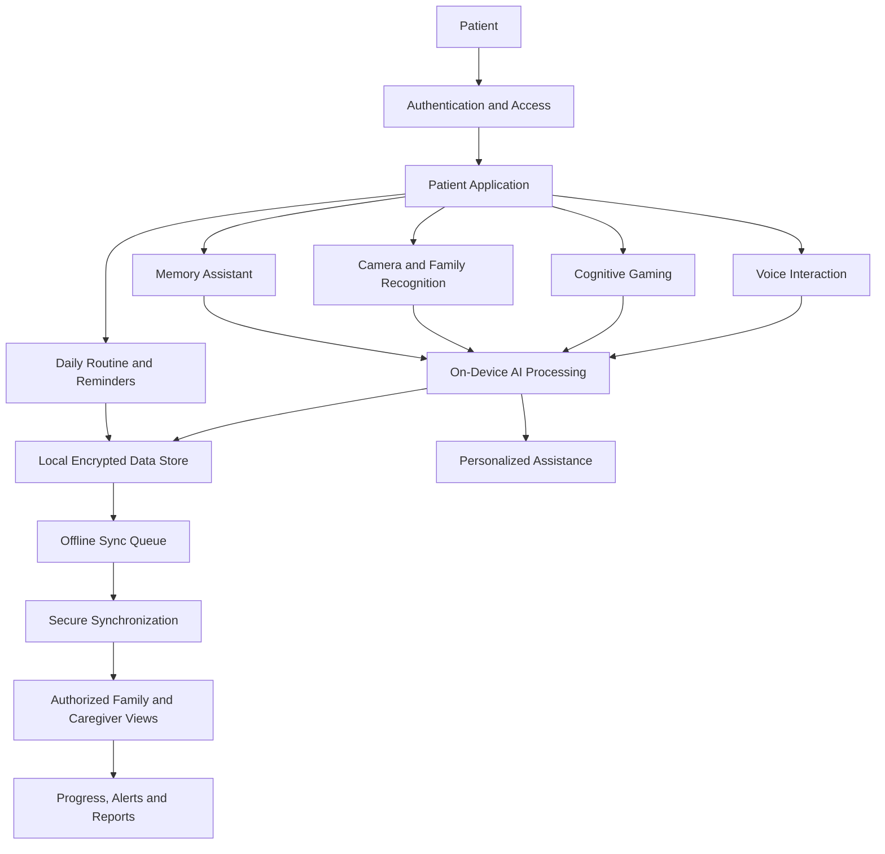
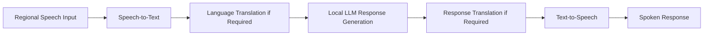
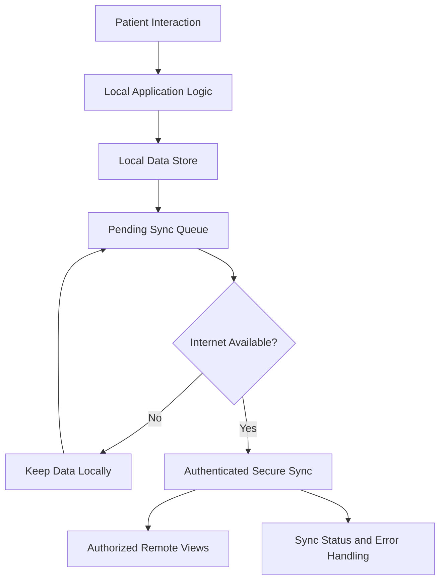

# SMARAN — Multimodal AI Platform for Cognitive & Elderly Care

<p align="center">
  <strong>Ek Ehsaas, Yaadon Ke Paas</strong><br/>
  <em>Technology in Service of Dignity</em>
</p>

<p align="center">
  An offline-first, AI-powered cognitive assistance and memory support platform designed for elderly people living with dementia and cognitive impairment, with a focus on the North Eastern Region (NER) of India.
</p>

---

## 📌 Project Information

| Field                       | Details                                                                                                              |
| --------------------------- | -------------------------------------------------------------------------------------------------------------------- |
| **Project Name**            | SMARAN — Multimodal AI Platform for Cognitive & Elderly Care                                                         |
| **Problem Statement ID**    | SIH26003                                                                                                             |
| **Problem Statement Title** | AI-Based Cognitive Gaming and Memory Assistance Platform for Elderly Dementia Patients in North Eastern Region (NER) |
| **Theme**                   | MedTech / BioTech / HealthTech                                                                                       |
| **PS Category**             | Software/Hardware                                                                                                    |
| **Team ID**                 | 149420                                                                                                               |
| **Team Name**               | Asymptotics                                                                                                          |
| **Primary Platform**        | Flutter / Dart                                                                                                       |
| **AI Approach**             | On-device inference, multimodal interaction, and personalized assistance                                             |
| **Core Design Principle**   | Offline-first, privacy-aware, elderly-friendly design                                                                |

---

## 🧠 1. Overview

SMARAN is an AI-powered cognitive assistance platform designed to support elderly people experiencing dementia-related memory difficulties and cognitive decline.

The platform combines adaptive cognitive games, multilingual voice interaction, family memory assistance, daily routine management, medication and hydration reminders, and caregiver monitoring within a unified application.

Unlike solutions that depend entirely on continuous internet connectivity or complex interactions, SMARAN is designed around accessibility, familiarity, privacy, and dependable assistance. Its offline-first approach aims to keep essential activities available on the user's device, even when network connectivity is limited.

SMARAN also recognizes the importance of family relationships and regional languages in elderly care, particularly across the culturally and linguistically diverse North Eastern Region of India.

The platform is intended to help patients maintain engagement with everyday activities while giving family members and caregivers a clearer picture of routines, reminders, and relevant changes in patient activity.

> **Our vision:** Make technology feel less like technology and more like a familiar, supportive presence in everyday life.

## 🎯 2. Problem Statement

**SIH26003 — AI-Based Cognitive Gaming and Memory Assistance Platform for Elderly Dementia Patients in North Eastern Region (NER)**

Dementia can affect memory, attention, recognition, communication, orientation, and the ability to complete everyday activities. These difficulties can create challenges for elderly individuals, their families, and their caregivers.

The need for accessible cognitive assistance is especially important in communities where internet access, language compatibility, and access to continuous personalized support may be limited.

Existing digital approaches may not adequately combine the following capabilities in one accessible system:

- Personalized cognitive engagement and memory exercises.
- Familiar-language voice interaction.
- Assistance with recognizing family members and recalling relationships.
- Medication, hydration, appointment, and daily activity reminders.
- Privacy-conscious processing when internet connectivity is unavailable.
- Meaningful patient activity updates for family members and caregivers.

SMARAN addresses these challenges through a unified, offline-first platform that combines cognitive engagement, memory assistance, daily routine support, and caregiver connectivity.

### Key challenges addressed

1. **Memory and recall difficulties:** Support through structured cognitive activities and contextual memory cues.
2. **Language barriers:** Natural voice interaction and regional-language support.
3. **Difficulty recognizing familiar people:** Family photographs, relationship information, and planned face-recognition assistance.
4. **Daily routine disruption:** Medication, hydration, appointments, and activity reminders.
5. **Caregiver uncertainty:** Patient progress summaries, activity history, missed-task notifications, and relevant alerts.
6. **Limited connectivity:** Local processing and storage, with synchronization when connectivity becomes available.
7. **Accessibility:** Large touch targets, readable interfaces, simple navigation, and calm, non-judgmental feedback.

---

## 💡 3. Our Solution

SMARAN combines five primary solution areas.

### 3.1 Adaptive Cognitive Engagement

SMARAN provides cognitive activities intended to encourage memory, attention, recall, and pattern recognition.

**Planned capabilities:**

- Memory and recall activities.
- Attention and pattern-recognition exercises.
- Personalized difficulty adjustment.
- Gameplay history and performance metrics.
- Progress tracking across cognitive activity sessions.
- Supportive feedback that avoids shaming users for mistakes.

The cognitive gaming engine is designed to adapt activity difficulty using gameplay history and performance indicators.

The purpose is to encourage regular cognitive engagement, not to diagnose dementia or claim that games reverse cognitive decline.

### 3.2 Multilingual Voice Assistance

SMARAN aims to make interaction easier for elderly users who may have difficulty navigating conventional interfaces.

**Planned capabilities:**

- Speech-to-text processing.
- Natural-language interaction.
- Context-aware AI responses.
- Text-to-speech responses.
- Regional-language input and output.
- Voice-assisted reminders and routine guidance.

The proposed language-processing pipeline combines automatic speech recognition, language translation where required, local language-model inference, response translation, and speech synthesis.

The initial language plan focuses on languages relevant to the North Eastern Region, with English and Hindi as additional interface and interaction options. Actual speech and translation support will depend on the availability and validation of suitable models for each language.

### 3.3 Family Memory Assistance

Personal memories and familiar relationships are central to the SMARAN experience.

**Planned capabilities:**

- Family photographs and familiar-person information.
- Names and relationship details.
- Contextual memory reinforcement.
- Personal memories and important notes.
- Family-provided information to help explain who a person is.
- Face-recognition assistance using locally stored reference data, subject to appropriate consent and testing.

For example, when a patient sees a familiar photograph, the application could display the person's name and relationship and provide an optional spoken reminder.

This feature is intended to support recognition and recall. It should not be treated as a definitive identity-verification system.

### 3.4 Smart Daily Assistance

SMARAN supports everyday routines through scheduled reminders and simple guidance.

**Planned capabilities:**

- Medication reminders.
- Hydration reminders.
- Appointment notifications.
- Daily activity assistance.
- Missed-task tracking.
- Local notifications and optional voice reminders.
- Caregiver-configured schedules.

Reminders should be easy to understand, visually clear, and reassuring rather than alarming.

Medication schedules and instructions should be configured or verified by an authorized caregiver or healthcare professional. SMARAN is not intended to independently prescribe or change medication.

### 3.5 Family and Caregiver Connectivity

SMARAN is designed to connect patient support with family and caregiver oversight.

**Planned capabilities:**

- Patient activity summaries.
- Cognitive game history and trends.
- Medication and routine adherence indicators.
- Important updates and alerts.
- Caregiver access to relevant patient information.
- Family-provided contextual information.
- Reports and analytics.
- Synchronization of permitted information when connectivity is available.

The caregiver interface aims to communicate meaningful status information instead of overwhelming caregivers with raw metrics.

Any automated alerts should be treated as assistance for human review, not as a medical diagnosis.

---

## 🏗️ 4. System Architecture

SMARAN is designed around a patient-facing Flutter application, local data storage, an on-device AI processing layer, and separate access experiences for patients, family members, and caregivers.

### 4.1 High-Level Architecture



*This diagram represents the intended system design. Individual components may be at different stages of implementation.*

### 4.2 User Access

The planned platform includes distinct access experiences for:

- **Patient:** Cognitive games, memories, orientation, voice assistance, and daily reminders.
- **Family member:** Family information, important updates, contextual memory information, and permitted patient updates.
- **Caregiver:** Patient monitoring, routine management, alerts, progress summaries, and reports.
- **Doctor or clinician:** A future or separately authorized clinical view for reviewing relevant cognitive activity trends and patient information.

Access should be role-based, with each user able to view or modify only the information they are authorized to access.

### 4.3 Central AI Processing Layer

The proposed architecture uses a local language model to support contextual understanding and personalized responses.

The planned model configuration is **Qwen 1.5B, quantized to Q4, using a GGUF model with llama.cpp**.

The AI processing layer is intended to:

- Interpret user requests and available context.
- Generate supportive conversational responses.
- Help coordinate memory and routine assistance.
- Support context-aware guidance.
- Integrate information from relevant application modules.

The language model is not intended to replace clinicians, independently diagnose medical conditions, or make unreviewed high-risk medical decisions.

### 4.4 Multimodal Inputs

SMARAN is designed to work with several kinds of input:

| Input                          | Intended purpose                                                         |
| ------------------------------ | ------------------------------------------------------------------------ |
| Voice                          | Spoken commands, requests, and conversational assistance                 |
| Touch and interaction events   | Navigation, game interactions, and optional interaction-pattern analysis |
| Camera                         | Family-photo and familiar-person recognition assistance                  |
| Application context            | Routine history, reminders, memories, and gameplay results               |
| Caregiver-provided information | Personal context, relationships, schedules, and preferences              |

These inputs should be processed only for clearly defined purposes, with appropriate consent and privacy safeguards.

---

## ⚙️ 5. Technical Implementation

### 5.1 Technical Implementation 1: Speech and AI Pipeline

The planned voice-processing pipeline contains five stages.



| Stage                  | Proposed technology                                     | Purpose                                         |
| ---------------------- | ------------------------------------------------------- | ----------------------------------------------- |
| Speech-to-text         | AI4Bharat IndicConformer; ONNX Runtime where compatible | Convert speech into text                        |
| Language translation   | IndicTrans2                                             | Translate text between supported languages      |
| AI response generation | Qwen 1.5B Q4, GGUF, llama.cpp                           | Generate context-aware responses locally        |
| Response translation   | IndicTrans2                                             | Translate the generated response where required |
| Text-to-speech         | AI4Bharat IndicTTS2; ONNX Runtime where compatible      | Generate spoken responses                       |

**Implementation note:** Model compatibility, supported languages, memory consumption, latency, and offline behavior must be validated on the target Android devices. These technologies are the proposed stack and should not be interpreted as proof that every model is already integrated.

### 5.2 Technical Implementation 2: Family Recognition and Cognitive Gaming

| Module                         | Proposed technology                                           | Purpose                                                 |
| ------------------------------ | ------------------------------------------------------------- | ------------------------------------------------------- |
| Face detection                 | MediaPipe or a compatible face-detection solution             | Locate faces in camera input                            |
| Face recognition               | InsightFace/ArcFace or a compatible model                     | Compare a detected face against enrolled reference data |
| Cognitive gaming               | Flutter, Dart, and Flame Engine                               | Implement interactive cognitive activities              |
| Difficulty optimization        | Rule-based logic, with optional future ML support             | Adjust activity difficulty using gameplay history       |
| Touch and interaction analysis | Flutter pointer events and custom analytics                   | Record permitted interaction patterns                   |
| Reminder scheduling            | Flutter local notifications and WorkManager where appropriate | Schedule reminders and background tasks                 |
| Voice reminders                | Flutter-compatible text-to-speech solution                    | Read reminders aloud                                    |

Face-recognition processing should use consent-based enrollment, secure reference-data storage, clear deletion controls, and testing across relevant ages, lighting conditions, and devices. The system must provide a fallback when recognition is uncertain.

Interaction timing and error patterns may be affected by motor ability, fatigue, device familiarity, vision, and other factors. Such measurements must not be presented as diagnostic conclusions without appropriate clinical validation.

### 5.3 Technical Implementation 3: Offline-First Data and Synchronization

SMARAN prioritizes local functionality and delayed synchronization.



**Proposed technologies:**

- SQLite for structured local storage.
- SQLCipher where encrypted database storage is required and supported.
- Drift ORM for structured database access in Flutter/Dart.
- WorkManager or suitable platform-specific scheduling for background work.
- HTTPS-based APIs for future remote synchronization.
- JSON for structured data exchange.

The implementation should distinguish local database encryption from transport security. Sensitive information must be protected both at rest and in transit, with appropriate key management, access controls, and recovery behavior.

The offline synchronization layer should account for failed requests, duplicate submissions, conflicting updates, deleted records, and interrupted transfers.

---

## 🧰 6. Technology Stack

| Layer                 | Technology                                      | Role                                     |
| --------------------- | ----------------------------------------------- | ---------------------------------------- |
| Mobile application    | Flutter                                         | Cross-platform application interface     |
| Programming language  | Dart                                            | Application logic and UI                 |
| Cognitive game engine | Flame Engine                                    | Interactive game implementation          |
| Local language model  | Qwen 1.5B Q4 / GGUF                             | On-device language generation            |
| LLM runtime           | llama.cpp                                       | Local language-model inference           |
| Speech recognition    | AI4Bharat IndicConformer                        | Proposed speech-to-text                  |
| Translation           | IndicTrans2                                     | Proposed regional-language translation   |
| Speech synthesis      | AI4Bharat IndicTTS2                             | Proposed text-to-speech                  |
| Model runtime         | ONNX Runtime                                    | Execution of compatible inference models |
| Face detection        | MediaPipe or compatible alternative             | Face localization                        |
| Face recognition      | InsightFace / ArcFace or compatible alternative | Familiar-person matching                 |
| Local database        | SQLite                                          | Structured application data              |
| Database encryption   | SQLCipher                                       | Encrypted database storage               |
| Database access       | Drift ORM                                       | Flutter database abstraction             |
| Background scheduling | WorkManager and platform-compatible scheduling  | Background jobs and synchronization      |
| Backend communication | HTTPS / REST API                                | Proposed remote synchronization          |
| Data interchange      | JSON                                            | Structured communication                 |

**Important:** This is the proposed technical stack. Actual dependencies, model versions, platform support, and completed integrations should be confirmed against the implementation before claiming that a component is production-ready.

---

## 🔐 7. Privacy, Security and Responsible AI

SMARAN may handle sensitive personal, health-related, behavioral, voice, and facial information. Privacy and security must therefore be core engineering requirements.

### Privacy principles

- **Data minimization:** Collect only information necessary for a defined feature.
- **Local-first processing:** Keep essential functionality available on-device wherever feasible.
- **Consent and transparency:** Explain what data is collected, why it is used, and who can access it.
- **Role-based access:** Separate patient, family, caregiver, and clinician permissions.
- **Secure storage:** Protect sensitive local data using appropriate encryption and key management.
- **Secure communication:** Use authenticated, encrypted transport for synchronization.
- **Controlled sharing:** Share patient information only with authorized recipients.
- **Deletion controls:** Provide appropriate ways to remove memories, personal information, and biometric enrollment data.
- **Resilient offline behavior:** Avoid losing essential records when connectivity is unavailable.
- **Human oversight:** Keep caregivers and qualified healthcare professionals involved in consequential decisions.

### Responsible AI principles

- AI responses should use calm, respectful, non-judgmental language.
- Uncertain face matches should never be presented as certain identities.
- Automated behavioral signals should be treated as observations, not diagnoses.
- AI-generated health-related suggestions must not replace professional medical advice.
- Caregivers should be able to review important alerts and correct inaccurate contextual information.
- The application should communicate limitations honestly and provide fallback options when models fail.

### Intended-use boundary

SMARAN is intended as a cognitive engagement, memory assistance, routine-support, and caregiver-support platform. It is not a substitute for medical diagnosis, professional dementia care, emergency services, or prescribed treatment.

Any clinical use, diagnostic claim, or medical decision-support capability would require appropriate validation, governance, and regulatory assessment.

---

## 👵 8. Elderly-Friendly User Experience

SMARAN is designed around the needs of elderly users and people who may experience memory, attention, communication, or navigation difficulties.

### Accessibility goals

- Large, clearly labeled touch targets.
- High-contrast text and meaningful visual hierarchy.
- Simple navigation with minimal interaction steps.
- Familiar photographs and recognizable visual cues.
- Optional voice guidance and spoken reminders.
- Calm colors and gentle animations.
- Supportive feedback rather than punitive error messages.
- Clear date, day, and time orientation.
- Readable reminders with simple wording.
- Graceful handling of slow responses, interrupted tasks, and uncertain recognition.

The interface should aim for strong accessibility, including WCAG-informed design practices where applicable. Accessibility claims should be validated through actual testing with intended users and assistive technologies.

---

## 📊 9. Caregiver and Clinical Support

### Caregiver support

The caregiver experience is designed to make essential information easier to understand and act upon.

Potential dashboard information includes:

- Patient activity and recent interactions.
- Medication and hydration reminder status.
- Cognitive game participation.
- Changes in activity history.
- Missed routine tasks.
- Important patient updates.
- Relevant alerts and follow-up suggestions.
- Trends across multiple observation periods.

Status indicators should have descriptive text and should not rely on color alone.

### Future clinical support

A separately authorized clinician-facing view could present:

- Memory-related activity trends.
- Attention and pattern-recognition activity history.
- Recall task performance.
- Longitudinal summaries.
- Relevant alerts and contextual notes.
- Exportable reports for professional review.

Game scores are not clinical cognitive assessments by themselves. Any clinical interpretation would require appropriate validation and oversight.

---

## 🌐 10. Offline-First Design

Offline-first operation is a core architectural goal for SMARAN.

### Expected offline behavior

Subject to the availability of the relevant local data, models, and device permissions, the application aims to support:

- Access to previously saved family memories.
- Cognitive games and local gameplay history.
- Scheduled reminders.
- Local patient profiles and routine information.
- On-device language-model interaction.
- Local data recording and a pending synchronization queue.

### Behavior when internet connectivity returns

When connectivity is available, the application may synchronize permitted information with authorized family or caregiver views.

The synchronization system should provide:

- Authentication and authorization.
- Secure transport.
- Retry handling.
- Conflict resolution.
- Duplicate prevention.
- Sync status visibility.
- Protection against unauthorized data access.

**Offline capability is feature-dependent.** Speech recognition, translation, text-to-speech, and language-model responses will work without internet only when the necessary compatible models and supporting resources are available locally and correctly integrated.

---

## 🗺️ 11. Development Roadmap

The following roadmap describes a practical implementation sequence. It is not a claim that all listed features are already complete.

### Phase 1 — Application Foundation

- [ ] Flutter/Dart application structure.
- [ ] Role-based entry and navigation.
- [ ] Patient, family, and caregiver experiences.
- [ ] Elderly-friendly UI components.
- [ ] Local database integration.
- [ ] Basic offline behavior.

### Phase 2 — Cognitive Engagement

- [ ] Memory and recall games.
- [ ] Attention and pattern-recognition games.
- [ ] Gameplay history and score tracking.
- [ ] Difficulty adjustment.
- [ ] Supportive feedback and accessibility testing.

### Phase 3 — Daily Assistance and Memories

- [ ] Family memory bank.
- [ ] Names, relationships, and personal context.
- [ ] Medication and hydration reminders.
- [ ] Daily routine scheduling.
- [ ] Local notifications.
- [ ] Missed-task tracking.

### Phase 4 — Multilingual AI

- [ ] Speech-to-text integration.
- [ ] Regional-language support validation.
- [ ] Translation pipeline.
- [ ] On-device language-model inference.
- [ ] Text-to-speech integration.
- [ ] Offline inference and performance testing.

### Phase 5 — Family Recognition

- [ ] Consent-based face enrollment.
- [ ] Face detection and local matching.
- [ ] Confidence thresholds and uncertain-match handling.
- [ ] Secure biometric data storage.
- [ ] Deletion and re-enrollment controls.

### Phase 6 — Caregiver Connectivity

- [ ] Patient activity summaries.
- [ ] Reminder and routine status.
- [ ] Relevant alerts.
- [ ] Secure synchronization.
- [ ] Caregiver dashboard.
- [ ] Report generation and longitudinal trends.

### Phase 7 — Validation and Readiness

- [ ] Functional testing across supported devices.
- [ ] Offline and synchronization testing.
- [ ] Privacy and security review.
- [ ] Performance and memory profiling.
- [ ] Regional-language testing.
- [ ] Accessibility testing with intended users.
- [ ] Caregiver feedback and usability evaluation.
- [ ] Appropriate clinical and regulatory review before any clinical claims.

---

## 🚀 12. Getting Started

The following instructions describe the expected workflow for running the Flutter application locally. They assume Flutter is installed and the project dependencies are compatible with your development environment.

### Prerequisites

- Flutter SDK.
- Dart SDK compatible with the project's Flutter version.
- Android Studio or another supported IDE.
- Android SDK and an emulator or physical Android device.
- Git.
- A compatible development environment for any platform-specific features.

Verify the Flutter installation:

```bash
flutter doctor
```

Check the installed Flutter and Dart versions:

```bash
flutter --version
dart --version
```

### Clone the team repository

```bash
git clone https://github.com/PRITAMADAK11052004/SMARAN_Asymptotics_SIH26003.git
```

Navigate into the Flutter application directory:

```bash
cd SMARAN_Asymptotics_SIH26003/Smaran(Flutter-Dart)
```

If your shell interprets the parentheses in the folder name, quote the path:

```bash
cd "SMARAN_Asymptotics_SIH26003/Smaran(Flutter-Dart)"
```

If you have already cloned the repository, navigate directly to the existing project directory instead of cloning it again.

### Install dependencies

```bash
flutter pub get
```

### Check the project

```bash
flutter analyze
```

### Run the application

Connect an Android device with USB debugging enabled or start an emulator.

```bash
flutter devices
```

Then run:

```bash
flutter run
```

### Build an Android APK

```bash
flutter build apk --release
```

The standard APK output location is:

```text
build/app/outputs/flutter-apk/app-release.apk
```

Build success depends on the actual project configuration, installed platform tools, native dependencies, and any required model assets.

### Troubleshooting

If dependency resolution fails:

```bash
flutter pub get
```

If generated build artifacts need to be recreated:

```bash
flutter clean
flutter pub get
```

Then retry the relevant build or run command.

**Caution:** `flutter clean` removes generated build files. It does not normally remove your Dart source code, assets, or project configuration. Do not delete model files or modify dependency versions without checking the project's requirements.

---

## 📁 13. Project Structure

The application is maintained in the `Smaran(Flutter-Dart)/` directory of the team repository.

The following is a representative Flutter project structure. The exact folders and filenames should be confirmed against the current repository.

```text
SMARAN_Asymptotics_SIH26003/
│
├── README.md
│
└── Smaran(Flutter-Dart)/
    ├── android/
    ├── ios/
    ├── linux/
    ├── macos/
    ├── windows/
    ├── web/
    │
    ├── assets/
    │   ├── images/
    │   ├── icons/
    │   ├── audio/
    │   └── models/
    │
    ├── lib/
    │   ├── main.dart
    │   ├── models/
    │   ├── screens/
    │   ├── widgets/
    │   ├── services/
    │   ├── database/
    │   └── utils/
    │
    ├── test/
    ├── pubspec.yaml
    ├── pubspec.lock
    └── README.md
```

Directory names inside `lib/` and `assets/` are illustrative. Refer to the actual source tree for the definitive structure.

---

## 🧪 14. Testing and Validation

SMARAN's reliability depends on testing the complete user experience, including offline operation and error handling.

### Functional testing

- Patient, family, and caregiver navigation.
- Reminder scheduling and notification delivery.
- Cognitive game interactions and result persistence.
- Memory creation, editing, and deletion.
- Role-based access restrictions.
- Voice interaction and fallback behavior.

### Offline testing

- Launching the application without internet access.
- Accessing locally saved memories and routines.
- Running supported on-device models without network access.
- Preserving game results and reminders.
- Reconnecting and synchronizing queued changes.
- Handling interrupted synchronization and conflicting updates.

### Security testing

- Unauthorized access to patient information.
- Secure local storage and key handling.
- Authentication and authorization checks.
- Secure network communication.
- Consent and deletion workflows for biometric data.
- Protection of sensitive logs and exported reports.

### Usability and accessibility testing

- Readability at different font sizes.
- Touch-target size and navigation simplicity.
- Voice guidance clarity.
- Regional-language pronunciation and comprehension.
- Recognition failures and fallback experiences.
- Testing with elderly users and caregivers where feasible.

### Performance testing

- Application launch time.
- Memory usage and model loading.
- On-device inference latency.
- Battery consumption.
- Background scheduling reliability.
- Behavior on supported low-resource devices.

Test results should be documented before performance, security, accessibility, or clinical-readiness claims are made.

---

## ⚖️ 15. Limitations and Responsible Use

SMARAN is a support platform, not a replacement for professional care.

- The usefulness of AI responses depends on model quality, context, and device performance.
- Language support varies by model and must be verified for each target language.
- Face recognition may fail because of lighting, image quality, appearance changes, or other factors.
- Local AI inference may require substantial memory and processing resources.
- Some features may be unavailable until the relevant models or services are integrated.
- Offline synchronization requires explicit handling of security, conflicts, and data recovery.
- Cognitive game performance must not be interpreted as a medical diagnosis.
- Reminder delivery depends on device permissions, operating-system behavior, and scheduling constraints.
- Clinical use requires appropriate validation, governance, and regulatory review.

When an AI feature is unavailable or uncertain, the application should offer a clear fallback and allow a caregiver to assist.

---

## 🌱 16. Future Scope

Potential future improvements include:

- Expanded, validated support for North Eastern regional languages.
- More efficient quantized AI models for lower-resource devices.
- Personalized cognitive activities based on longitudinal engagement.
- Improved caregiver insights and customizable reports.
- Secure family-to-patient memory sharing.
- Better handling of conflicting offline updates.
- Clinician-reviewed progress summaries.
- Integration with appropriate healthcare systems, subject to authorization, interoperability, privacy, and regulatory requirements.
- More comprehensive accessibility and usability evaluation.
- Carefully validated early-warning workflows that support, rather than replace, professional assessment.

Any future integration with healthcare infrastructure, including ABDM or HMIS systems, would require separate implementation, authorization, and compliance work.

---

## 👥 17. Team

**Team Name:** Asymptotics
**Team ID:** 149420
**Hackathon:** Smart India Hackathon
**Problem Statement:** SIH26003

Our team is working toward a practical, accessible, and privacy-conscious platform that connects cognitive engagement, memory assistance, everyday routines, and caregiver support.

---

## ❤️ 18. Our Philosophy

> **Memories Matter. Always.**

For an elderly person living with memory difficulties, a familiar face, a remembered relationship, a reassuring voice, or a simple daily routine can have meaningful value.

SMARAN aims to bring these forms of support together in a technology platform that respects the dignity of the person using it.

Our goal is not to replace human connection. It is to help patients, families, and caregivers preserve and strengthen that connection through thoughtful, accessible technology.

**SMARAN — Ek Ehsaas, Yaadon Ke Paas.**

*Technology in Service of Dignity.*

---

## 📄 License

A license has not been specified in this README. Add the project's approved license before distributing or reusing the code publicly.

## 📬 Contact and Contributions

For project-related questions, collaboration, or contributions, contact the SMARAN development team through the team's official GitHub repository:

[SMARAN — Asymptotics, SIH26003](https://github.com/PRITAMADAK11052004/SMARAN_Asymptotics_SIH26003)

Contributions should follow the team's agreed development workflow and respect the privacy and security requirements of an elderly-care application.
